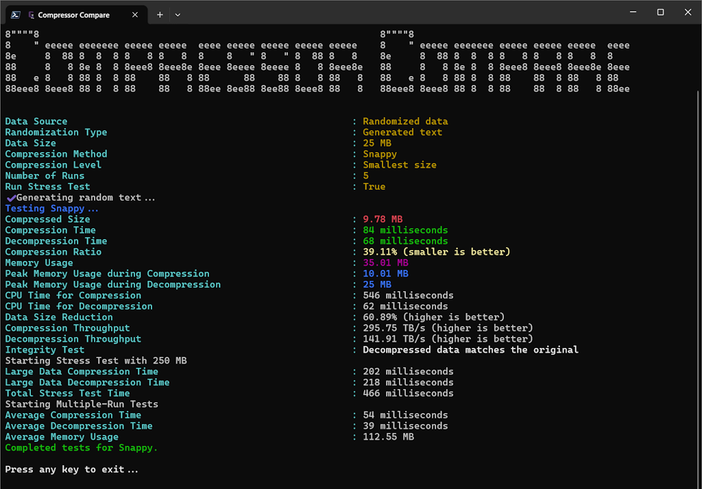

# 🗜️ abremir.CompressorCompare



## Motivation

Needed to run data compression tests with a specific file and, after doing a few searches, did not find quite what I was looking for.

Luckily, came across [bahri-hirfanoglu]'s [Compression Performance Tester](https://github.com/bahri-hirfanoglu/CSharpCompressionTester), which gave me a good starting point from which to build.

It should be noted that [TestCompressor.cs](./source/abremir.CompressorCompare/TestCompressor.cs), [CompressionClient.cs](./source/abremir.CompressorCompare/CompressionClient.cs), and some of the compression methods implemented in the [Compressors](./source/abremir.CompressorCompare/Compressors/) folder were heavily influenced by what can be found in the `Compression Performance Tester`.

## Features

```text
Description:
  🗜️ Compare data compressors head-to-head

Usage:
  abremir.CompressorCompare [command] [options]

Options:
  -?, -h, --help  Show help and usage information
  --version       Show version information

Commands:
  random            Test compression with randomly generated data
  file <file-path>  Test compression with a file
```

```text
Description:
  Test compression with randomly generated data

Usage:
  abremir.CompressorCompare random [options]

Options:
  -s, --size <size>                                       Size of random dataset in MB (> 0) [default: 10]
  -r, --randomization-type                                Randomization type for the random data [default:
  <GeneratedText|HighCompressibility|LowCompressibility>  LowCompressibility]
  -c, --compression-level <Fastest|Optimal|SmallestSize>  Compression level to be used [default: SmallestSize]
  -n, --number-of-runs <number-of-runs>                   Number of runs for multiple-run tests (>= 0) [default: 5]
  -m, --compression-method                                Compression method to be used [default: All]
  <All|Brotli|Deflate|GZip|LZ4|Snappy|ZLib|ZStd>
  -t, --stress-test                                       Run stress test
  -?, -h, --help                                          Show help and usage information
```

```text
Description:
  Test compression with a file

Usage:
  abremir.CompressorCompare file <file-path> [options]

Arguments:
  <file-path>  Path to the file to use

Options:
  -c, --compression-level <Fastest|Optimal|SmallestSize>  Compression level to be used [default: SmallestSize]
  -n, --number-of-runs <number-of-runs>                   Number of runs for multiple-run tests (>= 0) [default: 5]
  -m, --compression-method                                Compression method to be used [default: All]
  <All|Brotli|Deflate|GZip|LZ4|Snappy|ZLib|ZStd>
  -t, --stress-test                                       Run stress test
  -?, -h, --help                                          Show help and usage information
```

## Example

The screenshot above was captured after running the below command:

```pwsh
> .\abremir.CompressorCompare.exe random -s 25 -r GeneratedText -m Snappy
```

For file-based compression tests, you can find a large number of compression test datasets in [amkillam]'s [Compression Test Data](https://github.com/amkillam/compression-test-data).

## Dependencies &amp; Acknowledgements

* [command-line-api](https://github.com/dotnet/command-line-api)
* [Compression Performance Tester](https://github.com/bahri-hirfanoglu/CSharpCompressionTester)
* [Compression Test Data](https://github.com/amkillam/compression-test-data)
* [figgle](https://github.com/drewnoakes/figgle)
* [Humanizer](https://github.com/Humanizr/Humanizer)
* [K4os.Compression.LZ4](https://github.com/MiloszKrajewski/K4os.Compression.LZ4)
* [Kurukuru](https://github.com/mayuki/Kurukuru)
* [Pastel](https://github.com/silkfire/Pastel)
* [Snappier](https://brantburnett.github.io/Snappier/)
* [System.IO.Compression](https://learn.microsoft.com/en-us/dotnet/api/system.io.compression)
* [WaffleGenerator](https://github.com/SimonCropp/WaffleGenerator)
* [ZstdSharp](https://github.com/oleg-st/ZstdSharp)

---
